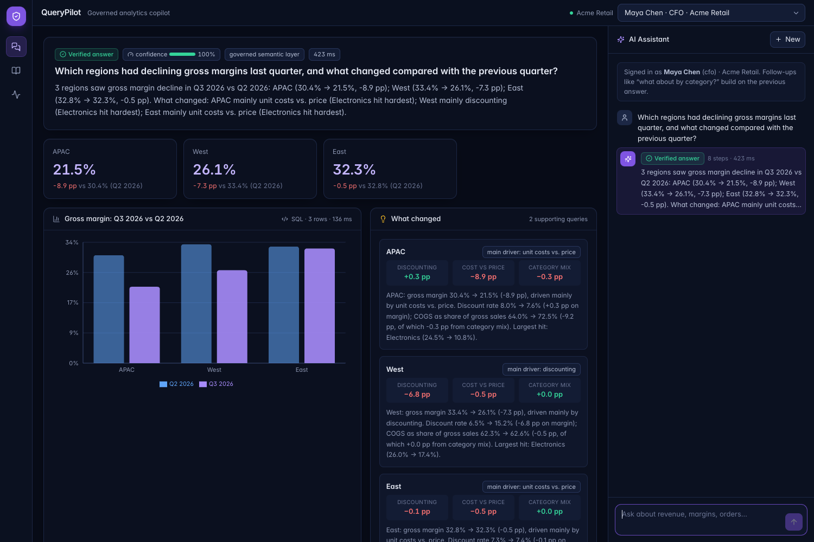
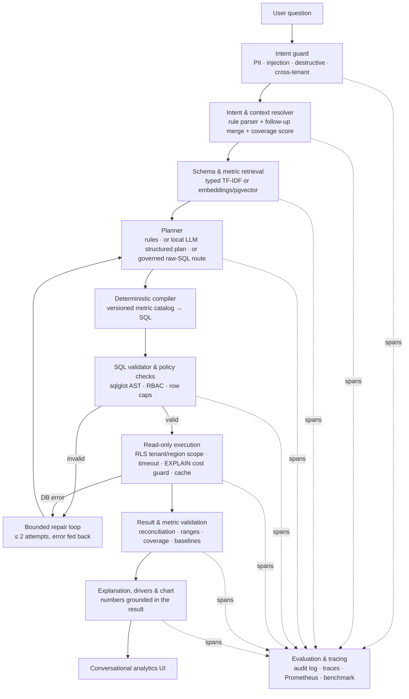

# QueryPilot — a governed enterprise analytics copilot

A CFO asks: *"Which regions had declining gross margins last quarter, and what changed compared with the previous
quarter?"* QueryPilot turns that into **verified SQL**, runs it **read-only inside the caller's tenant and role**,
**explains** the result, and shows the **evidence**: the exact SQL that ran, the versioned metric definitions, the
checks it passed, and a per-stage trace.



> APAC 30.4% → 21.5% (−8.9 pp), West 33.4% → 26.1% (−7.3 pp), East −0.5 pp. **What changed:** APAC — unit costs vs.
> price (Electronics hit hardest); West — discounting (discount rate 6.5% → 15.2%). These are exactly the events
> injected into the synthetic dataset ([docs/DATASET.md](docs/DATASET.md)), recovered by the driver decomposition.

Everything is free and open source: PostgreSQL + pgvector, FastAPI, LangGraph, sqlglot, scikit-learn, Next.js,
Recharts, Prometheus, Grafana, MLflow, and **local** LLMs through Ollama or any OpenAI-compatible server
(llama.cpp, vLLM, LM Studio). No paid APIs. The system also runs with **no model at all** — the rule-based planner
answers routine questions in milliseconds and the LLM is only needed for phrasings it can't cover.

---

## Architecture



| Stage | Implementation |
|---|---|
| Orchestration | `pipeline/graph.py` — LangGraph `StateGraph`, conditional edges, bounded repair cycle |
| Intent & context | `semantic/rules_planner.py` — metric/dimension/value/time/ranking extraction, follow-up merging, coverage-based confidence |
| Time resolution | `semantic/timeparse.py` — "last quarter", "H1 2026", "Q3 of 2025", YoY / previous period; models never do date math |
| Retrieval | `semantic/retriever.py` — typed top-k (metrics/dimensions/schema) with per-tenant value indexing; optional sentence-transformers + pgvector |
| LLM planning | `llm/planner.py`, `llm/client.py` — JSON-schema-constrained output from Ollama / OpenAI-compatible local servers |
| Semantic layer | `catalog/semantic_layer.yaml` + `semantic/compiler.py` — versioned metrics, joins, base filters, comparisons via CTE + FULL JOIN |
| Safety | `safety/policy.py`, `safety/validator.py`, `db/init/01_schema.sql` — see [docs/SECURITY.md](docs/SECURITY.md) |
| Execution | `pipeline/executor.py` — RLS context per transaction, `statement_timeout`, `EXPLAIN` cost ceiling, row cap, TTL result cache |
| Validation | `pipeline/checks.py` — independent-total reconciliation (catches join fan-out), ratio ranges, sign, coverage, missing baselines |
| Explanation | `pipeline/explain.py`, `pipeline/drivers.py` — template narrative from rows; margin decomposition into discount / cost / mix effects |
| Observability | `ops/tracing.py`, `ops/metrics.py`, `ops/store.py`, `ops/drift.py` — spans, Prometheus, append-only audit log, PSI drift |
| Evaluation | `eval/` — 284-question benchmark, independent gold SQL, scorer, report, CI gate, MLflow logging |

## What makes it enterprise-grade

| Requirement | How |
|---|---|
| **SQL safety** | Dedicated `qp_reader` role (`default_transaction_read_only`, `statement_timeout`, column-level grants); sqlglot AST validation: single SELECT, no DML/DDL/`SELECT INTO`/`FOR UPDATE`, function denylist, table allowlist, row caps; `EXPLAIN` cost guard |
| **Schema retrieval** | Only the relevant metrics, dimensions (with their values) and tables are retrieved and sent to the model; recall@8 = 97.9% on the benchmark |
| **Business correctness** | One YAML metric catalog with versions + changelog; formulas are compiled, never generated; every answer cites `metric vN`; catalog version is part of the cache key |
| **Query evaluation** | Execution accuracy, result accuracy, held-out phrasings, safety pass rate, false-block rate, abstention, latency, cost |
| **Reliability** | Bounded repair loop with structured validator/DB errors; confidence score; clarification instead of guessing when coverage is low; forecasts and out-of-scope questions declined |
| **Security** | RBAC (CFO / regional manager / analyst), Postgres row-level security for tenant **and** region isolation (fail closed), PII/salary blocked at three layers, append-only audit log, per-user rate limit |
| **Performance** | TTL result cache keyed by catalog version + tenant + scope + SQL; rules path needs zero LLM tokens; p50/p95 measured per stage |
| **Observability** | Spans for guard, resolver, retrieval, generation, validation, execution, result checks and explanation — in the UI, the DB and Prometheus/Grafana |

## Benchmark (honest numbers)

284 questions across simple aggregations, grouped metrics, multi-table joins, date comparisons, multi-turn follow-ups,
44 adversarial safety cases, tenant/region isolation and out-of-scope questions. Gold answers come from an
independently written SQL builder. **Held-out phrasings were never used to tune the planner.**

| Configuration: rules planner, no LLM | n | Result accuracy | Strict execution acc. | Safety pass | Unsafe executed | False blocks | p50 / p95 |
|---|---|---|---|---|---|---|---|
| **Held-out split** | 109 | **85.0%** | 75.0% | 95.5% | 0 | 0% | 33 / 243 ms |
| Dev split (tuned) | 175 | 100% | 85.5% | 100% | 0 | 0% | 52 / 321 ms |

Answers with confidence ≥ 0.8 were 97.6% correct; below 0.8, 64.7% (in hybrid mode those go to the LLM).
Method, per-category results, every failure and the limitations are in [backend/benchmark/README.md](backend/benchmark/README.md).
**The LLM path is covered by tests with a scripted model but has not been accuracy-benchmarked** — run
`QP_LLM_PROVIDER=ollama QP_PLANNER=llm python -m querypilot.eval.run` to measure it with your model.

## Quick start

### Docker (recommended)

```bash
cp .env.example .env
docker compose up --build            # Postgres+pgvector, API :8000, UI http://localhost:3000
```
The API seeds the demo data on first start. Switch users in the top-right to see RBAC and tenant isolation
(Maya = CFO, Raj = West-only regional manager, Ana = analyst, Li = CFO of a second tenant).

Optional profiles:
```bash
# Local LLM (free): start Ollama, pull a model once, use hybrid planning
QP_LLM_PROVIDER=ollama docker compose --profile llm up --build
docker compose exec ollama ollama pull qwen2.5-coder:7b

docker compose --profile observability up   # Prometheus :9090, Grafana :3001 (dashboard "QueryPilot")
docker compose --profile mlops up           # MLflow :5000
```

### Local development

Requires Python 3.11+, Node 20+, PostgreSQL 16 with pgvector.
```bash
# database: a superuser-capable role "querypilot" (password querypilot_dev) owning database "querypilot"
cd backend && pip install -e ".[dev]"
python -m querypilot.data.seed --schema                       # schema, roles, RLS + 80k orders
QP_REFERENCE_DATE=2026-10-10 uvicorn querypilot.api.main:app --reload --port 8000
cd ../frontend && npm install && npm run dev                   # http://localhost:3000
```
Tests, benchmark and gate: `pytest -q` · `python -m querypilot.eval.run` · `python -m querypilot.eval.gate` (or `make test bench gate`).

## Troubleshooting

**`api-1 | waiting for database: failed to resolve host 'db'`** (and then `ui-1 | ENOTFOUND api`)
Docker's internal DNS can't resolve the service names on your machine. The database itself is fine.
The `ui` error is only a consequence of the api having exited.

1. Recreate the containers and network cleanly (this fixes stale networks from earlier runs):
   ```bash
   docker compose down --remove-orphans
   docker network prune -f
   docker compose up --build --force-recreate
   ```
2. If it still happens, run `sh scripts/doctor.sh` (or `make doctor`). If even a throwaway container can't resolve
   `db`, VPN / endpoint-security software (Zscaler, Cisco AnyConnect, GlobalProtect, etc.) is usually intercepting
   Docker DNS: pause it and restart Docker Desktop.
3. The stack now works around it automatically: the api falls back to the database's host-published port via
   `host.docker.internal:5432` (log line `WARNING: using fallback database host`), and the UI proxy falls back to
   `host.docker.internal:8000`. To force it: `QP_DB_HOST=host.docker.internal docker compose up`.

**`database accepted TCP but login kept failing`** — the `pgdata` volume was created earlier with a different
`POSTGRES_PASSWORD`. Run `docker compose down -v` (deletes the demo DB; it is re-seeded on start).

**Port already in use (5432 / 8000 / 3000)** — stop the local service using it, or change the left side of the
`ports:` mapping in `docker-compose.yml` (e.g. `"5433:5432"`). Note the host fallback above assumes the default
`5432`/`8000` host ports.

## Configuration (`QP_*` environment variables)

| Variable | Default | |
|---|---|---|
| `QP_PLANNER` | `hybrid` | `rules`, `hybrid` (rules first, LLM when coverage < 0.8) or `llm` |
| `QP_LLM_PROVIDER` | `none` | `ollama` or `openai_compatible` (llama.cpp server, vLLM, LM Studio, LocalAI) |
| `QP_LLM_BASE_URL` / `QP_LLM_MODEL` | `http://localhost:11434` / `qwen2.5-coder:7b` | any local model with JSON output works |
| `QP_LLM_NARRATIVE` | `false` | let the LLM rephrase the narrative; rejected unless every number matches the data |
| `QP_RETRIEVER` | `tfidf` | `embedding` = sentence-transformers + pgvector (`pip install -e ".[embeddings]"`) |
| `QP_MAX_ROWS` / `QP_STATEMENT_TIMEOUT_MS` / `QP_MAX_PLAN_COST` | 1000 / 5000 / 5e6 | execution guardrails (roles may set lower row caps) |
| `QP_MAX_REPAIRS` | 2 | bounded repair attempts |
| `QP_MIN_CONFIDENCE` | 0.55 | below this the rules planner asks for clarification |
| `QP_REFERENCE_DATE` | today | pin "today" (the demo data ends 2026-09-30) |
| `QP_DB_ADMIN_URL` / `QP_DB_READER_URL` / `QP_DB_APP_URL` | local dev DSNs | owner (migrations/seed/gold), read-only RLS role, append-only ops role |

## API

| Method | Path | |
|---|---|---|
| POST | `/api/auth/demo-login` | `{user_id}` → JWT (replace with your IdP in production) |
| POST | `/api/ask` | `{question, conversation_id?}` → answer, table, chart spec, drivers, SQL, metric refs, checks, confidence, spans, usage |
| GET | `/api/catalog` | metrics, dimensions, versions, roles |
| GET | `/api/ops/summary` · `/api/ops/audit` · `/api/ops/traces/{id}` · `/api/ops/drift` · `/api/ops/benchmark` | operations |
| GET | `/metrics` · `/healthz` | Prometheus, health |

Interactive docs at `http://localhost:8000/docs`.

## Notes on the stack

* **pgvector over ChromaDB** — one fewer service; embeddings live next to the data and the audit log.
* **Evidently → custom PSI drift** (`ops/drift.py`) on question mix, outcome status and confidence — no extra dependency.
* **LightGBM is not used.** There's no tabular prediction task in the core loop; the confidence score is a transparent
  heuristic. A learned confidence model trained on benchmark traces is a sensible next step (see roadmap) and would
  need more labelled data than 284 questions to be trustworthy.
* MLflow logs benchmark runs (`--mlflow`); `pandas`/`scikit-learn` power retrieval and evaluation.

## Project layout

```
backend/
  catalog/            semantic_layer.yaml (metrics, dimensions, joins) · policies.yaml (roles, restricted data)
  db/init/            01_schema.sql — schema, read-only role, column grants, row-level security, ops tables
  querypilot/
    api/              FastAPI app, JWT auth, rate limiting
    pipeline/         LangGraph graph, executor, checks, drivers, explanation, service
    semantic/         catalog, rule planner, time parser, plan builder, compiler, retriever
    safety/           intent guard, RBAC, SQL validator, whitespace-only SQL formatter
    llm/              local-model client and structured planner / SQL generator
    ops/              tracing, Prometheus metrics, audit/trace store, drift
    eval/             benchmark builder, gold SQL, scorer, runner, CI gate
    data/             deterministic synthetic dataset
  benchmark/          questions.jsonl · results/latest.{json,md} · README.md (method & limitations)
  tests/              68 tests: validator, planner, compiler, scoring, RLS, end-to-end, LLM repair loop
frontend/             Next.js 14 + Tailwind + Recharts: ask workspace, catalog, ops & evaluation
infra/                Prometheus scrape config, Grafana datasource + dashboard
.github/workflows/    lint → tests → benchmark → quality gate → frontend build → docker build
```

## Limitations and roadmap

* Synthetic single-schema data; real warehouses need richer join graphs, entity resolution and value synonyms.
* The rule planner misses some phrasings (see the 13 held-out failures); five errors were confidently wrong, so
  calibration needs work — e.g. a learned confidence model and stricter unknown-term handling.
* The LLM route needs its own benchmark run with your chosen model before you rely on it.
* Docker images weren't built in the environment this was developed in (no registry access); the init SQL,
  entrypoint seeding, API and standalone UI server were each verified directly against PostgreSQL 16.
* Next: connectors for Snowflake/BigQuery/dbt semantic models, saved dashboards from answers, scheduled reports,
  human feedback loop feeding the benchmark, and a load test.
